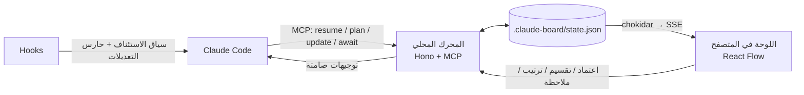

<div dir="rtl">

# CLAUDE FUN · لوحة كلاود

**محرك بصري خفيف يوضع داخل أي مستودع:** يرسل كلاود تحديثات JSON صغيرة، فتظهر أمامك لوحة تفاعلية حيّة على شكل شجرة تطوير، وأنت من يعتمد كل خطوة.

[English below ↓](#english)


## لماذا؟

في جلسات Claude Code تذهب نسبة كبيرة من التوكنز في فقرات تشرح الخطة وما تم إنجازه، وتضيع المتابعة بين سطور الطرفية. هذه الأداة تفصل **العرض** عن **البيانات**:

- الواجهة مبنية مسبقاً وتعمل محلياً، فلا يولّد كلاود أي واجهات أو شروحات.
- كلاود يرسل فروقات قصيرة فقط (Delta)، مثل `{"id":"S2.1","s":"done","n":"تم ربط قاعدة البيانات","t":"pass"}` بتكلفة 15 إلى 25 توكن تقريباً.
- عند العودة في اليوم التالي يقرأ كلاود ملخصاً واحداً أقل من 100 توكن بدلاً من المحادثات السابقة.
- لا يبدأ كلاود أي خطوة إلا بعد اعتمادك لها من اللوحة، والمحرك نفسه يرفض غير ذلك.

## كيف يعمل



## البدء السريع

```bash
npm i -g https://github.com/AKH3/CLAUDE_FUN/archive/refs/heads/main.tar.gz
```

```bash
cd my-project
claude-fun init
claude
```

شغّل `init` **داخل مجلد المشروع** وليس في مجلد المستخدم؛ الأداة ترفض مجلد المستخدم وجذر القرص لأن `.claude/settings.json` هناك هو إعدادات Claude Code العامة. يجهّز `init` المشروع، ثم يشغّل Claude Code خادم MCP تلقائياً ومعه اللوحة على `http://localhost:3000`. يعرض كلاود الرابط عند أول `resume`، ويمكنك فتح اللوحة يدوياً متى شئت بالأمر `claude-fun`.

لتجربة اللوحة بدون مشروع:

```bash
claude-fun demo --simulate
```

يفتح هذا الأمر مشروعاً تجريبياً، وفيه "كلاود وهمي" ينفّذ الخطوات التي تعتمدها، فترى البطاقات تتحرك وتضيء أمامك.

> يتطلب Node.js 22 أو أحدث، و git لعرض التعديلات (Diff). نثبّت من رابط الأرشيف وليس من `github:` لأن npm يترك رابطاً مكسوراً عند التثبيت العام من git.

> **على Windows (PowerShell):** إذا ظهر خطأ `UnauthorizedAccess` / `PSSecurityException` فسببه سياسة تشغيل السكربتات في PowerShell، وليس الأداة. الحل الأسرع أن تكتب `npm.cmd` بدل `npm` و `claude-fun.cmd` بدل `claude-fun`. أو اسمح بالسكربتات الموقّعة لحسابك مرة واحدة بالأمر `Set-ExecutionPolicy -Scope CurrentUser RemoteSigned`، وهذا قرارك لأنه إعداد أمان.

## ما الذي تراه في اللوحة

| الميزة | ماذا تفعل |
|---|---|
| **شجرة المراحل** | كل مرحلة عمود (من اليمين لليسار بالعربية)، والخطوات تحتها، والمهام الفرعية متفرعة منها. العقد تضيء عند الإنجاز، والمرحلة المكتملة تتحول للذهبي. |
| **بوابات الإذن** | البطاقة بانتظار الاعتماد تنبض، وفيها زر ✓ «اعتماد البدء» وزر ✂ «قسّم الخطوة». يوجد أيضاً زر «اعتماد المرحلة» لاعتماد مرحلة كاملة دفعة واحدة. |
| **كبسولة النتائج** | لكل خطوة منجزة: عدد الملفات، والأسطر المضافة والمحذوفة، وحالة الاختبار، والمدة، والتوكنز. يحسبها المحرك من git بنفسه، فلا تكلّف كلاود شيئاً. |
| **عرض التعديلات** | زر واحد يفتح diff الخطوة بالضبط، حتى بدون commits، لأن المحرك يلتقط شجرة العمل عند بداية الخطوة وعند نهايتها. |
| **عدّاد كفاءة التوكنز** | أرقام حقيقية من سجلات Claude Code، موزعة على المراحل والخطوات ومقارنة بالميزانية. |
| **أوامر صامتة** | عندما تسحب بطاقة لتغيير أولويتها أو تكتب ملاحظة، يتحول ذلك إلى سطر قصير يصل كلاود مع خطوته التالية، مثل `S3.1 prio 1; S2.4 note:"استخدم zod v4"`. |
| **حارس التعديلات** | في وضع «صارم» يمنع الهوك أي تعديل ملف، وأي أمر Bash يكتب ملفات (`>` و `sed -i` و `rm` و `git checkout` و `npm install`…)، ما لم تكن هناك خطوة معتمدة قيد التنفيذ. وضع «الحساس» يحمي `.env` والترحيلات وما شابهها فقط، ووضع «مطفأ» يلغي الحماية. |
| **عربي / English** | تبديل اللغة والاتجاه، وثيم داكن وفاتح. يمكن ضبطهما من الرابط أيضاً: `?lang=en&theme=light`. |

## بروتوكول التوكنز الصفري

أربع أدوات MCP فقط، وأوصافها قصيرة عمداً (تعريفاتها كلها نحو 600 توكن):

| الأداة | الاستخدام |
|---|---|
| `resume` | ملخص الحالة مع توجيهاتك غير المقروءة. أول ما يستدعيه كلاود. |
| `plan` | إضافة مراحل وخطوات دفعة واحدة. التقسيم يتم بتمرير `parent`. الخطوات الجديدة تنتظر اعتمادك. |
| `update` | الفروقات: `s:"run"` قبل العمل، ثم `done` أو `fail` بعده، مع ملاحظة لا تتجاوز 8 كلمات. |
| `await` | ينتظر حتى تعتمد أو ترسل توجيهاً من اللوحة، ثم يكمل كلاود تلقائياً. |

مثال على ما يقرأه كلاود عند الاستئناف:

```
متجر إلكتروني r42 | P3 "واجهة API" 2/4 | all 9/14 | tok 79k/250k
next S3.4 "التحقق من المدخلات بـ Zod"
wait S3.3 "رفع صور المنتجات" +3 need approval
msg S3.4 note:"use zod v4"; S3.3 prio 2
board http://localhost:3000
```

## ما الذي يضيفه `init`

لا يغيّر `init` شيئاً في كود مشروعك، ويمكن تشغيله أكثر من مرة بأمان:

- `.claude-board/state.json`: الخطة والحالة. يمكنك إضافته لـ git لتشاركه مع فريقك.
- `.claude-board/.gitignore`: يتجاهل ملفات التشغيل المؤقتة.
- `.mcp.json`: يضيف الخادم `board`.
- `.claude/settings.json`: يضيف الهوكس الثلاثة (`SessionStart` و`UserPromptSubmit` و`PreToolUse` على أدوات التعديل و Bash)، ويسمح بأدوات `mcp__board` حتى لا يُطلب إذنك عند كل تحديث، ويضبط `MCP_TOOL_TIMEOUT=600000` (10 دقائق) إن لم يكن مضبوطاً، حتى لا ينقطع `await` وأنت تراجع.
- `CLAUDE.md`: مقطع من 5 أسطر يذكّر كلاود بالبروتوكول.

خيارات مفيدة: `--guard sensitive` و `--no-hooks` و `--no-claude-md`.

## الأوامر

| الأمر | الوظيفة |
|---|---|
| `claude-fun` | يشغّل اللوحة للمشروع الحالي ويفتح المتصفح. |
| `claude-fun init` | يجهّز المستودع. |
| `claude-fun remove` | يلغي ما أضافه `init` بعد أخذ نسخة احتياطية. `--purge` يحذف اللوحة أيضاً، و `--backup <dir>` يحدد مكان النسخة. |
| `claude-fun status` | يطبع ملخص الاستئناف في الطرفية. |
| `claude-fun mcp` | خادم MCP عبر stdio. يستدعيه Claude Code بنفسه. |
| `claude-fun hook <name>` | معالجات الهوكس: `session-start` و `prompt` و `guard`. |
| `claude-fun demo --simulate` | لوحة تجريبية تتحرك وحدها. |

## الأمان

- الخادم يستمع على `127.0.0.1` فقط، ويرفض أي Host غير localhost، وهذا يحمي من هجمات DNS rebinding.
- أوامر الكتابة تتطلب ترويسة `x-board`، وتُرفض الطلبات القادمة من مواقع أخرى.
- الحارس يراقب أدوات `Edit` و`Write` و`MultiEdit` و`NotebookEdit`، وأوامر Bash التي تكتب ملفات. **حدّ معروف:** فحص Bash تقريبي يعتمد على أنماط شائعة، وليس عزلاً كاملاً.

## حل المشكلات

- **ينتهي `await` قبل أن تعتمد:** ينتظر `await` حتى 300 ثانية ثم يعود، ويرسل المحرك إشعارات تقدّم كل 15 ثانية. يضبط `init` المتغير `MCP_TOOL_TIMEOUT` على 10 دقائق، ويمكنك رفعه في `.claude/settings.json`.
- **مسار فيه مسافات** مثل `D:\Program Files x86`: يكتب `init` المسار بشرطات أمامية وبين علامتي تنصيص، فيعمل في bash وفي cmd.
- **المنفذ 3000 مشغول:** المحرك يجرّب المنافذ التالية تلقائياً، ويكتب المنفذ المستخدم في `.claude-board/.runtime.json`.
- **نقلت الأداة إلى مكان آخر:** أعد تشغيل `claude-fun init`، لأن الهوكس تشير إلى المسار المطلق للأداة.

## التطوير

```bash
npm install
npm run dev
```

```bash
npm test
```

```bash
npm run build
```

مجلد `dist/` محفوظ في المستودع حتى يعمل التثبيت من GitHub بدون أي بناء، لذلك شغّل `npm run build` قبل كل commit يغيّر الكود.

البنية: `src/core` (الحالة والانتقالات والقفل والملخص و git والتوكنز)، و `src/server` (Hono مع SSE)، و `src/mcp` (الأدوات الأربع)، و `src/hooks`، و `ui/` (React Flow مع Zustand و Tailwind).

</div>

---

<a id="english"></a>

## English

**A drop-in visual board for Claude Code.** Claude sends tiny JSON deltas through four MCP tools, and a local engine turns them into a live, game-like skill tree. You approve every step from the board.


### Why

Long progress narration burns tokens and buries the plan in terminal scrollback. Claude Board separates **view** from **data**:

- The UI is prebuilt, so Claude never generates UI or prose for status.
- Claude reports deltas such as `{"id":"S2.1","s":"done","n":"db wired","t":"pass"}`, about 15–25 tokens each.
- A resume summary under 100 tokens replaces re-reading old chats.
- Steps only run after you approve them on the board. The engine enforces this, so it doesn't depend on the prompt.

### Quick start

```bash
npm i -g https://github.com/AKH3/CLAUDE_FUN/archive/refs/heads/main.tar.gz
```

```bash
cd my-project
claude-fun init
claude
```

Run `init` inside a project folder: it refuses your home folder and drive roots, because `.claude/settings.json` there is your global Claude Code config. `claude-fun remove` undoes `init` (backing files up first; `--purge` also deletes the board). Claude Code launches the `board` MCP server, which also hosts the board at `http://localhost:3000`. To try it without a project, run `claude-fun demo --simulate`. Requires Node.js 22+, plus git for diffs.

**Windows PowerShell:** an `UnauthorizedAccess` error comes from PowerShell's script execution policy, not from this tool. Use `npm.cmd` and `claude-fun.cmd`, or allow signed scripts for your account with `Set-ExecutionPolicy -Scope CurrentUser RemoteSigned` (your call, since it is a security setting).

### Features

- **Skill-tree canvas:** phases as columns (mirrored in Arabic), steps beneath them, substeps branching off, and deps drawn as links. Nodes light up as they finish, and completed phases turn gold.
- **Permission checkpoints:** *Approve*, *Split*, *Reject* and *Retry* on every card, plus *Approve phase*.
- **Result capsules:** files changed, +/− lines, test status, duration and tokens, all computed by the engine from git snapshots taken in a throwaway index. No commits are needed and Claude spends zero tokens on them.
- **One-click diff** for exactly what a step changed.
- **Token efficiency meter:** real usage parsed from Claude Code's session logs, attributed to phases and steps, against a budget.
- **Silent directives:** dragging a card or writing a note becomes a one-line directive delivered with Claude's next tool call or prompt.
- **Edit guard hook:** `strict` (no file edits, and no file-writing Bash commands such as redirects, `sed -i`, `rm`, `git checkout` or `npm install`, unless an approved step is running), `sensitive` (protect `.env*`, migrations and similar) or `off`. The Bash check is a pattern heuristic, not a sandbox.
- **Arabic/English, dark/light**, also settable from the URL with `?lang=en&theme=light`.

### MCP tools

| Tool | Purpose |
|---|---|
| `resume` | Compact status plus unread user directives. Claude calls it first. |
| `plan` | Add phases and steps; pass `parent` to split. New steps await approval. |
| `update` | Deltas: `s:"run"` before work, `done`/`fail` after, a note of 8 words or fewer, and test status. |
| `await` | Long-poll until the user approves or sends a directive. |

### What `init` writes

`.claude-board/` (state plus its own `.gitignore`), the `board` server in `.mcp.json`, hooks, an `mcp__board` allow rule and `MCP_TOOL_TIMEOUT=600000` (unless already set) in `.claude/settings.json`, and a 5-line snippet in `CLAUDE.md`. Hook commands use a quoted forward-slash path, so install folders with spaces work in both bash and cmd. All files are merged, never overwritten, and re-running is safe.

### Development

`dist/` is committed so installing from GitHub needs no build step; run `npm run build` before committing code changes. `npm install`, then `npm run dev` (engine on 4317 plus Vite), `npm test` (unit tests and an end-to-end MCP/HTTP/SSE/hooks suite), and `npm run build`.

## License

MIT
